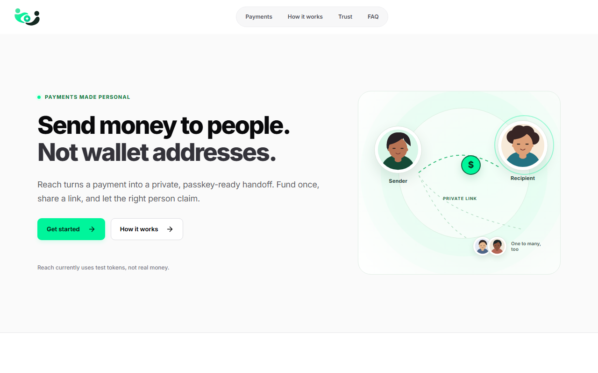
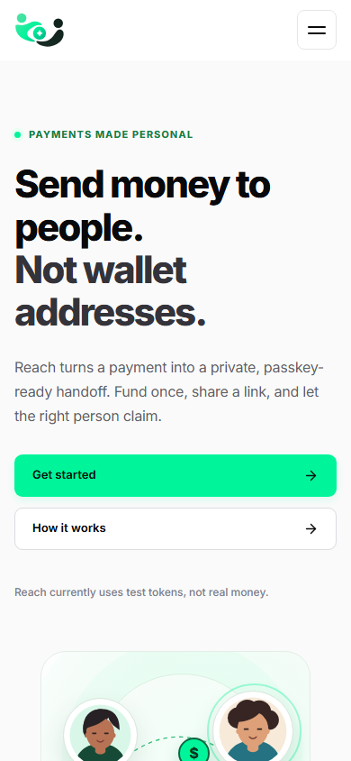
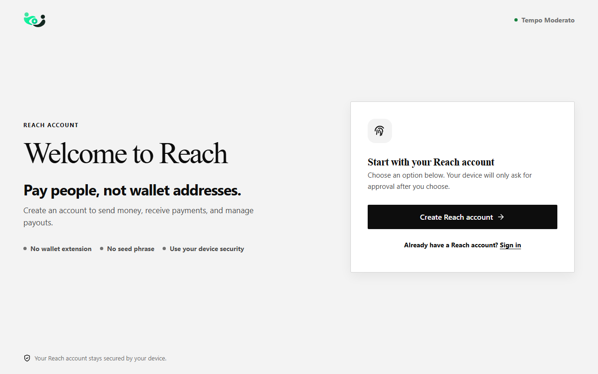
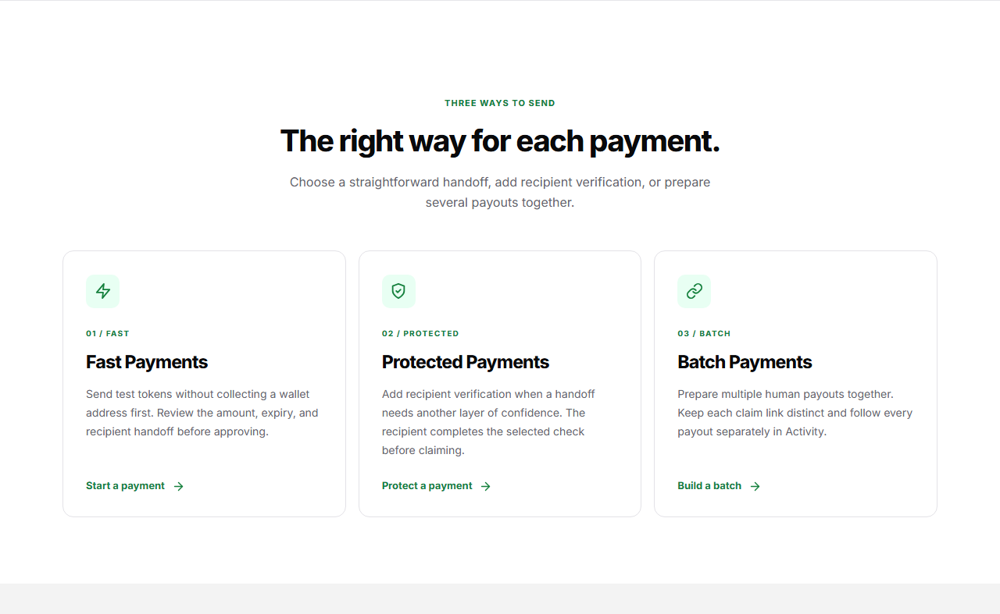

# Reach

**Send testnet stablecoin payments to people, even when a recipient does not have a wallet address yet.**

[Open the live Reach app](https://reach-seven-lemon.vercel.app/) · [View screenshots](docs/images/) · [Read the architecture decision](docs/architecture-decision.md) · [Inspect the payout vault](contracts/ReachPayoutVault.sol)



Reach is a passkey-powered human-payments application for Tempo Moderato testnet. A sender funds a payout, shares a private claim link, and the recipient completes account entry and claiming in Reach. The product is designed around a simple question:

> How do I pay someone if they have not set up a wallet address?

Reach currently uses pathUSD test tokens on Tempo Moderato, chain **42431**. It is a testnet application, not a real-money payment service.

## Why Reach exists

Address-first transfers make recipient wallet setup a prerequisite for payment. Reach separates the sender's funding step from the recipient's account step:

```text
Sender passkey account -> funded payout vault -> private claim link
                                                   -> recipient passkey account
                                                   -> claim or sender reclaim after expiry
```

This is a focused product choice, not a claim that payment links or passkey wallets are unique to Reach.

## Three human-payment experiences

| Experience | What the sender does | Recipient handoff |
| --- | --- | --- |
| **Fast Payment** | Reviews one amount and expiry, then funds one payout. | Shares one private claim link. |
| **Protected Payment** | Adds an available recipient-verification channel before funding. | Completes the configured check before the claim capability is released. |
| **Batch Payment** | Reviews multiple recipients and payouts in one guided flow. | Receives a separate claim link and status for each payout. |

The current Batch Payment flow supports up to 25 recipients in one atomic passkey transaction. The application keeps payment state and claim capabilities separate so an individual recipient link can be recovered or reclaimed without inventing a new authorization.

| Mobile landing | Account entry | Payment modes |
| --- | --- | --- |
|  |  |  |

These images are captures of the reviewed browser UI. They are not evidence that a real financial transaction settled.

## How a payment moves

1. **Open Reach.** Create or return to a passkey account.
2. **Read the account.** Reach displays the account address and reads the testnet pathUSD balance.
3. **Fund the sender.** Use the Funding screen when the configured testnet funding service is available, or use an already funded testnet account.
4. **Choose a payment.** Select Fast, Protected or Batch, review the amount and expiry, then approve the account transaction that funds the payout vault.
5. **Share privately.** Give each intended recipient their claim link. The claim capability is stored in the URL fragment, not in a public payout index.
6. **Claim or reclaim.** The recipient signs in or registers with a passkey and claims. After expiry, only the original sender can reclaim an eligible unclaimed payout.
7. **Check Activity.** Activity and payout detail read the available payment state and receipts, while uncertain outcomes remain recoverable instead of being shown as confirmed settlement.

An unprotected claim link is a **bearer capability**. Anyone with the complete link can use it, so it must be shared privately. If it is lost, Reach cannot recreate its secret from public payout data. Protected Payments add a separate verification step, but they depend on correctly configured delivery providers.

## Passkey accounts and claims

Reach uses passkeys for account entry and sender authorization. The application derives the Tempo account from the authenticated passkey flow and keeps the transaction approval in the user's browser ceremony.

Claim links are private capabilities. The payout vault verifies the claim signer, recipient state, expiry and terminal transition onchain. The sender can reclaim only an eligible payout after expiry. A lost passkey or lost claim capability may not be recoverable; device and browser recovery options vary.

## Architecture

| Layer | Implementation | Responsibility |
| --- | --- | --- |
| Web client | React, TypeScript, Vite, wagmi and viem | Passkey entry, Funding, Send, Batch, Claim and Activity journeys |
| API | Hono and the Accounts WebAuthn library | Authentication, account state, payout discovery, protected delivery and guarded testnet funding routes |
| Persistence | Upstash-compatible Redis REST adapter | Durable sessions and private workflow state in a deployed environment |
| Settlement contract | Solidity and Hardhat | Holds funded pathUSD entitlements and enforces claim, expiry and sender reclaim |
| Chain | Tempo Moderato testnet, chain 42431 | Testnet balances, account operations and authoritative payout reads |

The server has operational authority for passkey sessions, optional recipient verification and fee sponsorship. It does not custody the payout balance held by the vault. Read the [authorization decision](docs/architecture-decision.md) for the boundary details.

## Repository map

```text
contracts/       Solidity vault, interfaces and test mocks
docs/            Architecture notes, product evidence and screenshots
public/          Reach branding, icons and web manifest
scripts/         Doctor, build, verification and testnet utilities
src/client/      React account, payment, claim and Activity experiences
src/server/      Hono API, authentication, persistence and read services
src/shared/      Shared chain, identity and transaction types
test/            Unit, contract and Playwright browser coverage
api/index.js     Bundled server entry used by the Vercel deployment
```

## Run Reach locally

Prerequisites: Node.js **24.14 or newer**, pnpm **11.19 or newer**, and a browser with passkey support.

```sh
pnpm install --frozen-lockfile
cp .env.example .env.local
pnpm run doctor
pnpm dev
```

Open `http://localhost:5173`. On PowerShell, the equivalent copy step is `Copy-Item .env.example .env.local`. `pnpm run doctor` checks the runtime, dependencies and configuration without printing secret values.

The example file contains variable names and public testnet defaults only. Do not commit `.env.local`, place a signing key in a `VITE_*` variable, or reuse production credentials. Local memory storage can exercise the UI and tests but does not preserve passkey accounts across server restarts. A deployed account requires durable KV and a matching HTTPS `REACH_ORIGIN` and `REACH_RP_ID`.

### Environment variables

The checked-in `.env.example` documents the complete interface without secret values.

| Variables | Purpose |
| --- | --- |
| `VITE_TEMPO_RPC_URL`, `VITE_REACH_VAULT_ADDRESS` | Browser-safe testnet reads and the public vault address |
| `REACH_ORIGIN`, `REACH_RP_ID`, `REACH_RPC_URL`, `REACH_VAULT_ADDRESS` | Server origin, WebAuthn relying-party identity and chain configuration |
| `KV_REST_API_URL`, `KV_REST_API_TOKEN` | Durable server-side sessions and private workflow state |
| `REACH_FEE_PAYER_PRIVATE_KEY` | Optional server-only testnet sponsorship |
| `REACH_PROTECTED_CLAIMS_ENCRYPTION_KEY` and delivery-provider variables | Optional Protected Payment delivery |

Missing service configuration must be reported as unavailable. It must never be replaced with a simulated balance, payment or receipt.

## Verification

Run the checks from the repository root:

```sh
pnpm typecheck
pnpm test:unit
pnpm test
pnpm check:api-drift
pnpm build:web
pnpm exec playwright test --workers=1 test/browser/task015-landing.spec.ts
```

`pnpm test:unit` covers the current unit and server suite. `pnpm test` runs the local Hardhat vault and batch contract tests. `pnpm test:browser` runs the broader Playwright suite. Browser fixtures and local contract tests do not establish that a deployed payment settled on Tempo.

The reviewed local candidate most recently passed **155/155 unit and server tests**, **36/36 local contract tests**, and **82/82 browser tests**. A focused deployed visual check also passed **10/10** scenarios. These are reproducibility and UI checks, not a substitute for separately approved real testnet financial acceptance.

## Security model and limits

- The payout vault validates claim authorization, recipient state, expiry and one-time terminal transitions.
- Private claim capabilities live in URL fragments and are not listed by a public payout index.
- Durable KV is required for deployed identities and sessions. The application fails closed when required persistence is unavailable.
- Protected Payments depend on configured server-only SMS or email delivery.
- Sponsorship is conditional on its server-side service being available.
- A missing or uncertain authoritative receipt is not a confirmed payment. Recovery keeps the state uncertain until it can be checked.
- Reach is testnet-only. It is not a mainnet payment service, bank transfer or fiat off-ramp.
- No claim is made here about universal passkey recovery, commercial traction or completed real-money UAT.

The Tempo integration previously surfaced a token return-data discrepancy. The exact observation and boundary are documented in [`docs/live-discrepancy.md`](docs/live-discrepancy.md).

## Hackathon context

Reach was built for the Crypto World's Fair at Colosseum. The live application is the primary judge-facing demo. No demo video is linked until one is actually published.

## Roadmap

These are future improvements, not currently supported capabilities:

- More flexible batch-file imports, including Excel, pasted lists and eventually structured Word documents.
- Enhanced passkey recovery, including supported cross-device or account-recovery mechanisms.
- Additional recipient delivery and notification options.
- Further Batch Payment usability improvements.
- Production-network readiness after security, infrastructure and financial acceptance.

## License

No project license has been declared by the owner.
